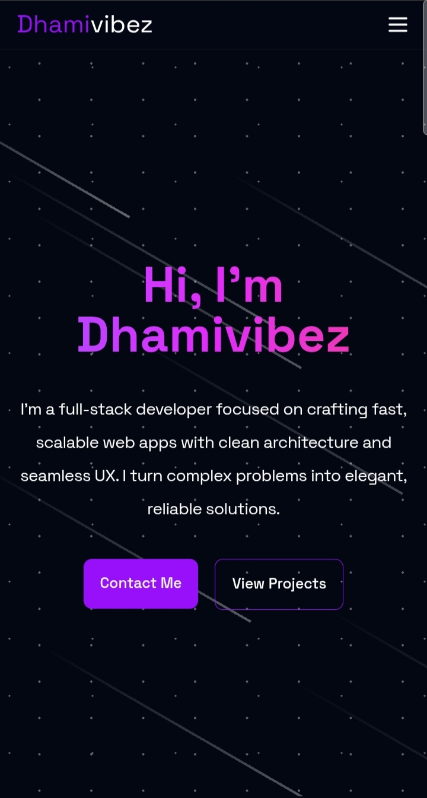

# Jafar Abdulsalam



I’m a full-stack developer focused on crafting fast, scalable web apps with clean architecture and seamless UX. I turn complex problems into elegant, reliable solutions.

---

## Local Development

Use Bun 1.4.4 or newer for its built-in TypeScript checker and formatter.

```sh
bun install
bun run dev
```

- `bun check` — type-check the project without writing files.
- `bun fmt` — format the project, including Tailwind CSS class sorting.
- `bun fmt --check` — check formatting without writing files.
- `bun run build` — build the portfolio.
- `bun run serve` — preview the build locally.

Formatting preferences live in `bunfig.toml`. There is no lint script for now, and Cloudflare Workers deployment is no longer configured.

---

## Tech I Use

**Languages**  
JavaScript(TypeScript)

**Frameworks**  
React/NextJS · Express · Hono · Elysia · Tanstack Start

**Tools & Platforms**  
PNPM · Bun · Vite · Supabase

---

## What I’ve Built

This portfolio showcases a collection of projects I’ve built that reflect how I think, solve problems, and build interfaces.  
It features:

- Smooth animations
- Responsive design
- Highlighted projects
- Contact form
- Custom layouts & components

---

## Explore My Work

> [dhamivibez.name.ng](https://dhamivibez.name.ng)

---

## Connect With Me

- [LinkedIn](https://linkedin.com/in/dhamivibez)
- [GitHub](https://github.com/dhamivibez)
- [X (Twitter)](https://x.com/0xdhamivibez)

---
